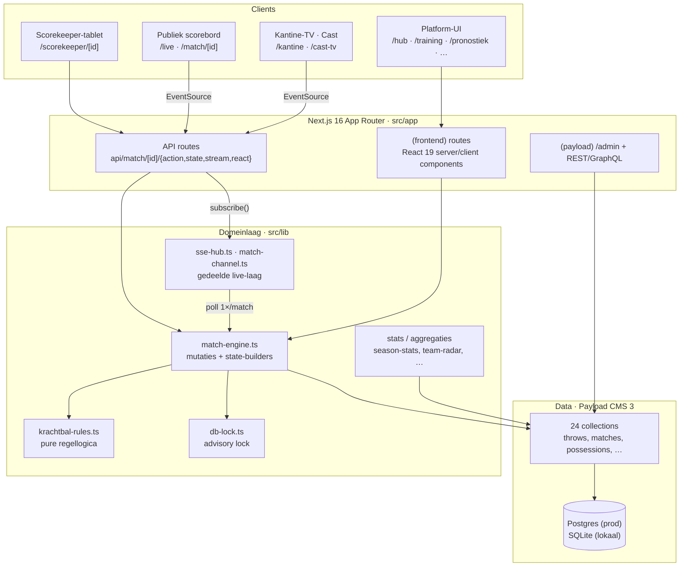
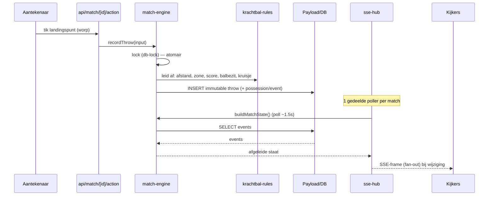
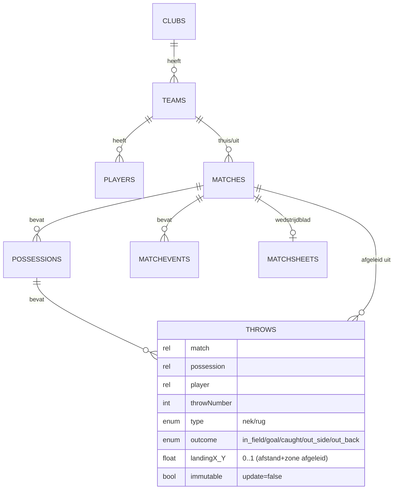

# Architectuur — Krachtbal Live

Een kaart van de codebase: lagen, dataflow en feature-clusters. Bedoeld voor
onboarding en om snel het juiste bestand te vinden. Voor *waarom*-keuzes en regels:
zie [`PROJECT.md`](../PROJECT.md), [`KRACHTBAL-REGLEMENT.md`](../KRACHTBAL-REGLEMENT.md)
en [`CLAUDE.md`](../CLAUDE.md).

Schaal (juni 2026): ~545 TS/TSX-bestanden, ~61k regels, 24 Payload-collections,
~100 `lib`-modules, ~40 frontend-routes, ~25 API-routes.

## Lagen

## Kern-dataflow: event-sourcing

Elke worp is een **immutable** event. Score, balbezit, worpteller, kruisjes en
stats worden **afgeleid** — nooit los opgeslagen. Undo = laatste worp verwijderen.

Waarom dit zo is, en wat je daardoor **niet** mag doen (afgeleide staat opslaan,
een throw bewerken, per-connectie pollen): zie [`CLAUDE.md`](../CLAUDE.md).

## Hart van het systeem

| Module | Rol |
|---|---|
| `src/lib/match-engine.ts` | Alle match-mutaties (`startMatch`, `recordThrow`, `undoLastThrow`, `finishMatch`, time-outs, lineup) **en** state-builders (`buildMatchState`, `buildMatchStats`, `buildTimeline`, `buildScoreboards`). Begin hier voor live-match. |
| `src/lib/krachtbal-rules.ts` | Pure regellogica (afstand, zone, worpteller, score, balbezit, kruisjes). Geen DB. Regels wijzig je hier. |
| `src/lib/sse-hub.ts` | Gedeelde SSE-infra: één poller per sleutel → fan-out, per-IP-cap, rate-limit, `SSE_HEADERS`. |
| `src/lib/match-channel.ts` | Match-specifieke kanaallaag (reacties, viewer-count) bovenop de hub. |
| `src/lib/db-lock.ts` | Postgres advisory lock per match (cross-instance). No-op op SQLite. |
| `src/lib/score-trust.ts` | Pure vertrouwensregels op een supporters-score: official scorer per wedstrijd, gewogen consensus, trust-score per gebruiker. Opslag in `score-trust-store.ts`. |
| `src/payload.config.ts` | Payload-config: collections, globals, DB-adapter-keuze (Postgres/SQLite), CORS/CSRF. |

## Datamodel (Payload-collections)

Kern (event-sourcing): **`throws`** (immutable events) · **`possessions`** ·
**`matchevents`** · **`matches`** · `teams` · `players` · `clubs`.

Daaromheen, per feature-cluster:

- **Wedstrijdblad/federatie**: `matchsheets`, `officials`, `accidents` (medisch,
  GDPR-gevoelig), `sanctions`, `cupfinals`
- **Tornooien**: `tournaments`, `tournamentmatches`
- **Training & voeding**: `trainingen`, `trainingdoelen`, `trainingmetingen`
- **Engagement/overig**: `matchmvpvotes`, `matchinstants`, `news`, `advertenties`,
  `pushsubscriptions`, `media`, `users`
- **Globals**: `season`, `settings`

## Feature-clusters (route ↔ lib)

| Cluster | Routes (`src/app/(frontend)`) | Lib (`src/lib`) |
|---|---|---|
| **Live & score** | `/live`, `/match/[id]`, `/scorekeeper/[id]`, `/veld`, `/kantine`, `/cast` | `match-engine`, `krachtbal-rules`, `sse-hub`, `match-channel`, `match-momentum`, `win-probability` |
| **Statistiek** | `/analyse`, `/rangschikking` | `season-stats`, `team-radar`, `radar-stats`, `expected-points`, `team-efficiency`, `match-analysis`, `player-danger`, `attack-patterns`, `standings` |
| **Wedstrijdblad** | `/aftekenen`, `/beheer` | `submit/`, `matchsheet-data`, `matchsheet-workflow`, `officials-rules` |
| **Training & voeding** | `/training`, `/opstelling` | `training-plan`, `training-metrics`, `nutrition-plan`, `calorie-tracker`, `food-database`, `gameplan` |
| **Engagement** | `/hub`, `/pronostiek`, `/fans`, `/profiel`, `/wrapped`, `/superster`, `/recap` | `badges`, `fan-score`, `pronostiek-*`, `prediction-score`, `scorecard`, `mvp-vote`, `tribune`, `checkins`, `weekly-recap`, `team-of-the-week`, `match-report` |
| **Clubs & federatie** | `/clubs`, `/club`, `/federatie`, `/scheidsrechter`, `/vergoedingen`, `/bekerfinale` | `club-colors`, `reeksen`, `reeks-standings`, `referee-credentials`, `vergoeding`, `sanctions` |
| **Nieuws & info** | `/nieuws`, `/reglement`, `/uitleg`, `/demo`, `/prijzen` | `reglement`, `demo`, `krachtbal-quotes` |

## Live-laag (waarom de SSE-hub bestaat)

Vroeger pollde **elke** SSE-connectie zelf de DB (~15 queries/1.5 s). Met N kijkers
werd dat N×15 → een finale met duizenden telefoons legde de DB-pool plat. De
gedeelde hub draait **één** poller per match en doet fan-out naar alle abonnees:
DB-kost blijft constant ongeacht het publiek. Voor échte horizontale schaal hoort
dit later achter Redis pub/sub (nu per-instance in-memory). Zie `AUDIT-2026-06.md` §2/§6.

## Vertrouwen op een supporters-score

In supporters-modus (`settings.scoreMode`) mag élke ingelogde supporter de score
doorgeven. Om dat betrouwbaar te houden zonder de drempel te verhogen:

- **Eén official scorer per wedstrijd.** Wie als eerste aantekent, claimt de match
  automatisch; anderen worden geweigerd door `mayScoreMatch` (`api-auth.ts`) en
  kunnen enkel nog bevestigen of betwisten. De claim vervalt na 45 min stilte, zodat
  een lege batterij een wedstrijd nooit blokkeert.
- **Gewogen consensus.** Andere kijkers stemmen via `/api/match/[id]/trust`; het
  gewicht van een stem hangt af van de (onzichtbare) trust-score van de stemmer.
- **Label op de stand.** `buildMatchState` en `buildScoreboards` geven een
  `trust`-blok mee: 🟢 officieel/bevestigd, 🟡 nog niet bevestigd, 🔴 betwist.
- **Trust-score per gebruiker** (`users.scoreTrust`, alleen leesbaar voor federatie):
  na het bevestigingsvenster (24 u) boekt `/api/cron/recap` het oordeel; wie
  herhaaldelijk bevestigd wordt, gaat meteen als bevestigd door de deur.

## Seizoensimport

De federatie levert het speelplan als één bestand met álle reeksen. `/beheer/planning` neemt een
**Excel (.xlsx)**, CSV of geplakte tekst aan en maakt in één keer de ontbrekende clubs, ploegen en
wedstrijden aan. Drie lagen:

- `src/lib/xlsx-read.ts` — minimale .xlsx-lezer (ZIP + XML via `zlib`, zonder extra afhankelijkheid,
  net als de PDF-parser). Zet Excel-datumgetallen om naar leesbare datums.
- `src/lib/season-import.ts` — puur: kolommen herkennen (aan de koprij, of aan de inhoud wanneer
  die ontbreekt), datum/uur lezen in Belgische tijd, reeks resolven, dubbels detecteren.
- `src/lib/season-import-run.ts` — schrijft weg. Twee standen: proef (niets wegschrijven, enkel
  rapporteren) en echt. Opnieuw importeren is veilig: bestaande wedstrijden (zelfde reeks, dag en
  ploegen) worden overgeslagen.

De aantekenmodus zelf schakel je om op `/federatie` (`ScoreModeSwitch` → `/api/settings/score-mode`).

## Wekelijkse recap

`/recap` toont de vorige speelweek (uitslagen, ploeg van de week, selectie van de
week, klimmers), volledig afgeleid — er wordt geen recap opgeslagen. Het endpoint
`/api/cron/recap` (beveiligd met `CRON_SECRET`, dagelijks aan te roepen) sluit de
vertrouwenslaag af en pusht op maandag het overzicht.

## Deploy

GitHub → Railway (Railpack, Node 24). Postgres-service + Volume voor media. Prod
draait migraties (`payload migrate`); lokaal SQLite met dev-push. Details:
[`docs/DEPLOY.md`](DEPLOY.md).

## Tests

`tests/unit` (vitest, snel — regellogica/stats) · `tests/int` (vitest, integratie)
· `tests/e2e` (playwright). Helpers in `tests/helpers`.
