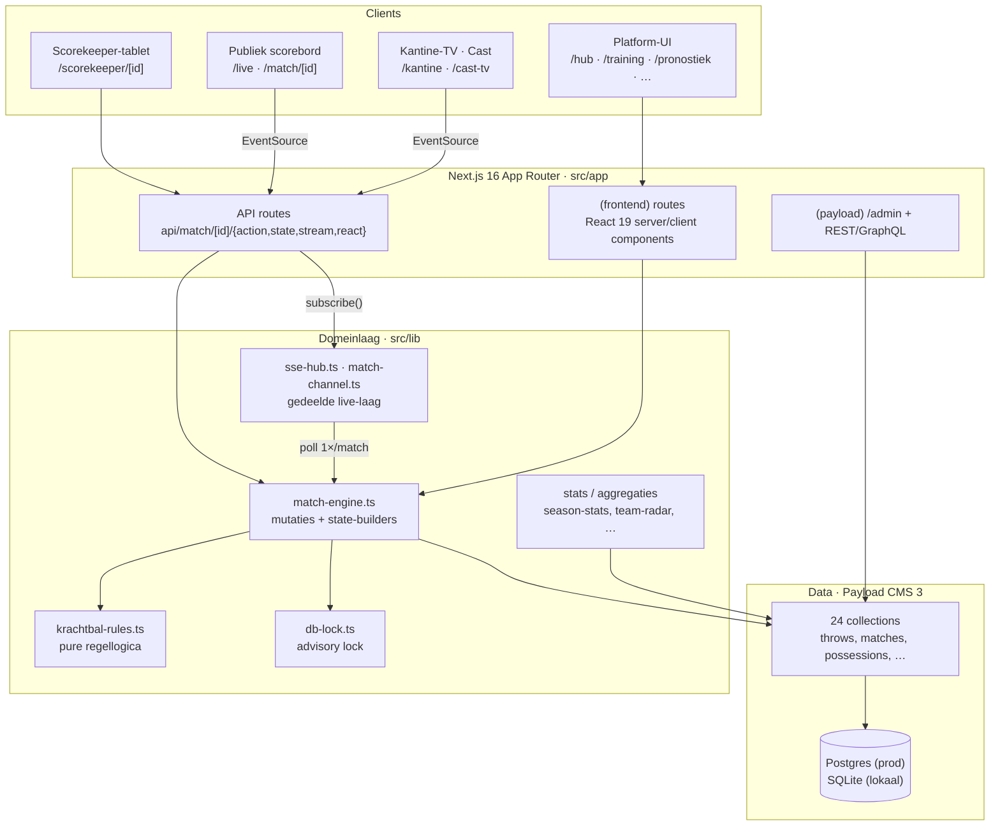
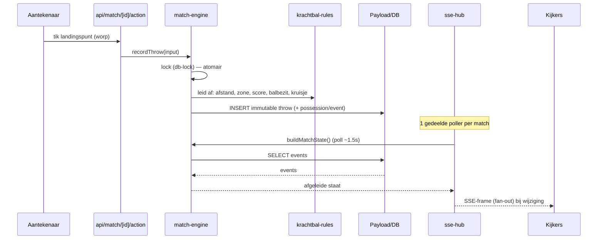
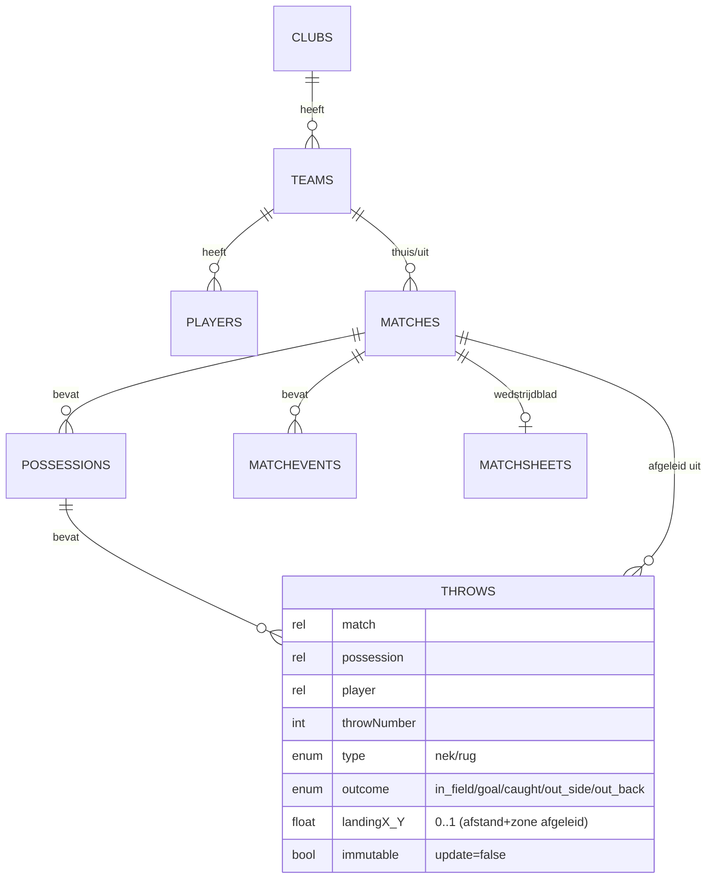

# Architectuur — Krachtbal Live

Een kaart van de codebase: lagen, dataflow en feature-clusters. Bedoeld voor
onboarding en om snel het juiste bestand te vinden. Voor *waarom*-keuzes en regels:
zie [`PROJECT.md`](../PROJECT.md), [`KRACHTBAL-REGLEMENT.md`](../KRACHTBAL-REGLEMENT.md)
en [`CLAUDE.md`](../CLAUDE.md).

Schaal (juni 2026): ~545 TS/TSX-bestanden, ~61k regels, 24 Payload-collections,
~100 `lib`-modules, ~40 frontend-routes, ~25 API-routes.

## Lagen

## Kern-dataflow: event-sourcing

Elke worp is een **immutable** event. Score, balbezit, worpteller, kruisjes en
stats worden **afgeleid** — nooit los opgeslagen. Undo = laatste worp verwijderen.

Waarom dit zo is, en wat je daardoor **niet** mag doen (afgeleide staat opslaan,
een throw bewerken, per-connectie pollen): zie [`CLAUDE.md`](../CLAUDE.md).

## Hart van het systeem

| Module | Rol |
|---|---|
| `src/lib/match-engine.ts` | Alle match-mutaties (`startMatch`, `recordThrow`, `undoLastThrow`, `finishMatch`, time-outs, lineup) **en** state-builders (`buildMatchState`, `buildMatchStats`, `buildTimeline`, `buildScoreboards`). Begin hier voor live-match. |
| `src/lib/krachtbal-rules.ts` | Pure regellogica (afstand, zone, worpteller, score, balbezit, kruisjes). Geen DB. Regels wijzig je hier. |
| `src/lib/sse-hub.ts` | Gedeelde SSE-infra: één poller per sleutel → fan-out, per-IP-cap, rate-limit, `SSE_HEADERS`. |
| `src/lib/match-channel.ts` | Match-specifieke kanaallaag (reacties, viewer-count) bovenop de hub. |
| `src/lib/day-channel.ts` | Eén kanaal voor álle wedstrijden van één dag (de borden op `/` en `/live`). |
| `src/lib/kantine-channel.ts` | Eén kanaal voor álle borden van één kantinescherm. **Een verzamelbord opent nooit een verbinding per wedstrijd**: een dozijn borden zou een dozijn open verbindingen uit dezelfde browser betekenen, en daar loopt een browser op vast. |
| `src/lib/db-lock.ts` | Postgres advisory lock per match (cross-instance). No-op op SQLite. |
| `src/lib/score-trust.ts` | Pure vertrouwensregels op een supporters-score: official scorer per wedstrijd, gewogen consensus, trust-score per gebruiker. Opslag in `score-trust-store.ts`. |
| `src/payload.config.ts` | Payload-config: collections, globals, DB-adapter-keuze (Postgres/SQLite), CORS/CSRF. |

## Datamodel (Payload-collections)

Kern (event-sourcing): **`throws`** (immutable events) · **`possessions`** ·
**`matchevents`** · **`matches`** · `teams` · `players` · `clubs`.

Daaromheen, per feature-cluster:

- **Wedstrijdblad/federatie**: `matchsheets`, `officials`, `accidents` (medisch,
  GDPR-gevoelig), `sanctions`, `cupfinals`
- **Tornooien**: `tournaments`, `tournamentmatches`
- **Training & voeding**: `trainingen`, `trainingdoelen`, `trainingmetingen`
- **Engagement/overig**: `matchmvpvotes`, `matchinstants`, `news`, `advertenties`,
  `pushsubscriptions`, `media`, `users`
- **Globals**: `season`, `settings`

## Feature-clusters (route ↔ lib)

| Cluster | Routes (`src/app/(frontend)`) | Lib (`src/lib`) |
|---|---|---|
| **Live & score** | `/live`, `/match/[id]`, `/scorekeeper/[id]`, `/veld`, `/kantine`, `/cast` | `match-engine`, `krachtbal-rules`, `sse-hub`, `match-channel`, `match-momentum`, `win-probability` |
| **Statistiek** | `/analyse`, `/rangschikking` | `season-stats`, `team-radar`, `radar-stats`, `expected-points`, `team-efficiency`, `match-analysis`, `player-danger`, `attack-patterns`, `standings` |
| **Wedstrijdblad** | `/aftekenen`, `/beheer` | `submit/`, `matchsheet-data`, `matchsheet-workflow`, `officials-rules` |
| **Training & voeding** | `/training`, `/opstelling` | `training-plan`, `training-metrics`, `nutrition-plan`, `calorie-tracker`, `food-database`, `gameplan` |
| **Engagement** | `/hub`, `/pronostiek`, `/fans`, `/profiel`, `/wrapped`, `/superster`, `/recap` | `badges`, `fan-score`, `pronostiek-*`, `prediction-score`, `scorecard`, `mvp-vote`, `tribune`, `checkins`, `weekly-recap`, `team-of-the-week`, `match-report` |
| **Clubs & federatie** | `/clubs`, `/club`, `/federatie`, `/scheidsrechter`, `/vergoedingen`, `/bekerfinale` | `club-colors`, `reeksen`, `reeks-standings`, `referee-credentials`, `vergoeding`, `sanctions` |
| **Wedstrijddag** | `/scheidsrechter/[id]`, `/match/[id]`, `/scorekeeper/[id]` | `aftrap` (aftrap verschuiven + meeschuiven), `afgelasting`, `blessure`, `use-action-queue` (wachtrij, hartslag), `score-trust` (overnemen), `submit/pdf-noodblad` |
| **Planning** | `/beheer/inschrijvingen`, `/club/inschrijving`, `/beheer/planner`, `/beheer/kalender` | `inschrijving`, `kalender-planner` (Berger + koppels + lokale zoektocht, puur), `kalender-plan-server`, `kalender-generator`, `verplaatsing` |
| **Boetes & kosten** | `/beheer/boetes`, `/club/boetes` | `boetes` (voorstellen, opleggen, betwisten, scheidsrechterskosten) |
| **Nieuws & info** | `/nieuws`, `/reglement`, `/uitleg`, `/demo`, `/prijzen` | `reglement`, `demo`, `krachtbal-quotes` |

## Live-laag (waarom de SSE-hub bestaat)

Vroeger pollde **elke** SSE-connectie zelf de DB (~15 queries/1.5 s). Met N kijkers
werd dat N×15 → een finale met duizenden telefoons legde de DB-pool plat. De
gedeelde hub draait **één** poller per match en doet fan-out naar alle abonnees:
DB-kost blijft constant ongeacht het publiek. Voor échte horizontale schaal hoort
dit later achter Redis pub/sub (nu per-instance in-memory). Zie `AUDIT-2026-06.md` §2/§6.

## Vertrouwen op een supporters-score

In supporters-modus (`settings.scoreMode`) mag élke ingelogde supporter de score
doorgeven. Om dat betrouwbaar te houden zonder de drempel te verhogen:

- **Eén official scorer per wedstrijd.** Wie als eerste aantekent, claimt de match
  automatisch; anderen worden geweigerd door `mayScoreMatch` (`api-auth.ts`) en
  kunnen enkel nog bevestigen of betwisten. Vóór de aftrap vervalt de claim na 45 min
  stilte; op een lopende wedstrijd vervalt ze niet vanzelf. Valt het toestel uit (lege
  batterij), dan kan iemand anders **overnemen** (actie `overnemen`): de scheidsrechter of
  de federatie meteen, een andere aantekenaar na 3 min zonder teken van leven (het
  aantekenscherm stuurt elke minuut een hartslag `aanwezig`). Zie `overneemWeigering` in
  `score-trust.ts`. Lukt ook dat niet: het noodblad (`/api/matchsheet/[id]/pdf?nood=1`)
  en achteraf de eindstand van papier door de federatie (`papierenuitslag`).
- **Gewogen consensus.** Andere kijkers stemmen via `/api/match/[id]/trust`; het
  gewicht van een stem hangt af van de (onzichtbare) trust-score van de stemmer.
- **Label op de stand.** `buildMatchState` en `buildScoreboards` geven een
  `trust`-blok mee: 🟢 officieel/bevestigd, 🟡 nog niet bevestigd, 🔴 betwist.
- **Trust-score per gebruiker** (`users.scoreTrust`, alleen leesbaar voor federatie):
  na het bevestigingsvenster (24 u) boekt `/api/cron/recap` het oordeel; wie
  herhaaldelijk bevestigd wordt, gaat meteen als bevestigd door de deur.

### De wedstrijddagflow valt weg in supporters-modus

In federatie-modus is de wedstrijddag een keten: **opstelling → scheidsrechter →
aantekenen → aftekenen**, en elke schakel bewaakt de volgende (`match-readiness.ts`,
`matchsheet-workflow.ts`). In supporters-modus valt die keten weg — dat is wat de
schakelaar op `/federatie` belooft. De regel voor de knoppen staat op één plek,
puur en getest: **`lib/wedstrijddag-acties.ts`** (`clubActies` + `primaireActie`).

Concreet:

- `/club` toont dan enkel *Aantekenen* (primair) + *Bekijk*, geen *Opstelling* en geen
  «⏳ Wacht op scheidsrechter». Die laatste was een **doodlopende straat**: het
  wedstrijdblad blijft in supporters-modus op `concept` staan, dus
  `sheetOpenForScoring()` werd nooit waar en een geplande thuiswedstrijd viel er niet
  te starten.
- `/opstelling/[matchId]`, `/scheidsrechter/[matchId]` en `/aftekenen/[matchId]` tonen
  een korte «niet nodig in supporters-modus»-pagina met één knop naar het aantekenen
  (`components/FlowNietNodig.tsx`). Ze stoppen **vóór** `getOrCreateMatchSheet()`, want
  anders maakte het louter openen van zo'n pagina een wedstrijdblad aan voor een
  wedstrijd die er geen hoort te hebben.
- `MatchDayNav` (de vier genummerde stappen) heeft daardoor geen eigen uitzondering
  nodig: die drie pagina's zijn de enige rendersites ervan.
- Analyse-opnames (`match.analyseOnly`) houden hun opstellingscontrole altijd — zonder
  opstelling kan een worp niet aan een speler gekoppeld worden.
- Wat **niet** wegvalt: de scheidsrechter-*aanduiding*. `/api/scheidsrechter/wedstrijd/[matchId]`
  kent geen modus, dus een scheidsrechter kan ook in supporters-modus een wedstrijd claimen —
  het blad ontstaat dan alsnog. `/club`, `/match/[id]` en het portaal blijven die naam dus
  tonen; enkel de bladstatus verliest haar poortfunctie.

Dezelfde laag ligt op **tornooiwedstrijden** (`tournament-matches.scoreTrust`, zelfde
vorm — `readMatchTrust`/`writeMatchTrust` nemen de collectie als argument). Op een
tornooidag spelen tien velden tegelijk en zit er lang niet achter elk veld iemand van
de organisatie; in supporters-modus laat `magTornooiAantekenen(user, supportersModus)`
daarom élke ingelogde bezoeker meetellen. Verschillen met een gewone wedstrijd:

- Claimen, bevestigen en betwisten lopen over hetzelfde actie-endpoint
  (`/api/tournament/[id]/match/[matchId]/action`, acties `bevestig`/`betwist`) —
  tornooien hebben geen aparte trust-route.
- Een supporter krijgt de **basis**-aantekentafel (+1 nekworp / +2 rugworp), niet het
  volledige blad met scorerkeuze: vanaf de zijlijn zie je zelden welk rugnummer scoorde.
- `SUPPORTER_ACTIES` in die route zet de grens: meetellen mag (start, goal, undo, klok,
  helft, kruisjes, minuten, einde), dagorganisatie en correcties niet (`plan`, `veld`,
  `wissel`, `reset`, `reopen`) — dezelfde grens als `mayCorrectMatch` bij een gewone
  wedstrijd.
- `buildTournamentState` geeft het label mee als `TMatchState.trust`; het bord toont het
  strookje per wedstrijdkaart (`MatchTrust.tsx`), en `null` betekent: de organisatie
  tekent zelf aan, er valt niets te bevestigen.

## Wie tekende deze wedstrijd aan? (tornooien)

Bij een betwiste uitslag is de eerste vraag altijd dezelfde. Voor tornooiwedstrijden staat het
antwoord vast in twee json-kolommen op `tournament-matches`: `aantekenaars` (lijst van
`{id, naam, rol, eerste, laatste, acties}`) en `afgeslotenDoor` (`{id, naam, op}`). De regels zijn
puur en getest in `src/lib/aantekenaars.ts`; de opslag zit in `aantekenaars-store.ts`.

- **Dit is géén afgeleide staat.** Uit de doelpunten valt niet te herleiden wie ze intikte, dus
  wordt het geboekt — binnen dezelfde lock als de mutatie, want het is een lees-wijzig-schrijf op
  één json-kolom.
- **Voor iederéén die aantekent**, niet alleen supporters. De vertrouwenslaag (`scoreTrust`) raakt
  enkel wedstrijden waar een supporter meetelt; precies de wedstrijden die de organisatie invulde
  bleven daardoor anoniem.
- **De naam is een momentopname naast de id**, zoals `MatchInstants.authorName`: `users.read` is
  federatie-only, dus een publieke pagina kan de naam later niet meer via een join ophalen.
- **Nooit een e-mailadres.** `veiligeNaam()` valt terug op "Aantekenaar" bij een leeg veld en
  weigert alles met een `@` — het privacybeleid zegt dat namen publiek zijn en adressen niet.
- **Weergave**: `buildTournamentState` levert `TMatchState.aantekenaar` (kant-en-klare zin), en het
  tornooibord zet die als voetnoot onder de wedstrijdkaart. Het vertrouwensstrookje toont daarom
  zelf geen naam meer — anders stond dezelfde naam er twee keer.
- **Finished-guard.** `eisNietAfgelopen` in `tournament-engine.ts` weigert undo, kruisjes,
  minuten, scheidsrechter-minuten, klok en helft op een afgelopen wedstrijd; `finishMatch` eist
  bovendien dat de wedstrijd lóópt. Zonder die twee kon een afgesloten finale teruggedraaid worden
  terwijl de winnaar bleef staan, en kon een nog niet gespeelde wedstrijd "beëindigd" worden mét
  winnaar — die dan via `applyToSlot` in de volgende ronde geschreven werd. Sinds supporters mogen
  meetellen was dat pad voor élk ingelogd account bereikbaar (CLAUDE.md, invariant 3).
- **Beheer**: `/beheer/aantekenaars` (federatieniveau) bundelt het per persoon en per wedstrijd.
  Daarnaast staat `tournament-matches` nu zichtbaar in de Payload-admin, met `aantekenaars` als
  kolom en twee kleine componenten (`AantekenaarInfo.tsx`) die er een leesbare regel en een
  tabelletje van maken in plaats van ruwe json.
- **Zichtbaar ≠ bewerkbaar.** Diezelfde collectie kreeg `create/update/delete: () => false`. Zonder
  die regels valt Payload terug op "elke ingelogde gebruiker mag schrijven", en de admin staat voor
  iedereen met een account open — terwijl de stand event-sourced is en een handmatige wijziging het
  schema uit balans zou brengen. De tornooi-engine schrijft overal met `overrideAccess: true` en
  gaat er dus gewoon langs. Let op bij het testen hiervan: de **Local API draait standaard mét**
  `overrideAccess`, dus een access-test moet expliciet `overrideAccess: false` meegeven, anders
  bewijst ze niets.
- **Dezelfde terugval gold breder.** `tournaments`, `throws`, `possessions` en `match-events`
  hadden enkel een `read`-regel; voor de rest viel Payload terug op "elke ingelogde gebruiker mag
  schrijven". Bij `tournaments` was dat het zwaarst: de `beforeDelete`-hook wist het volledige
  wedstrijdschema mee, dus één DELETE door een willekeurig lid vaagde een tornooidag leeg. Bij
  `throws` betekende het dat een worp buiten `match-engine.ts` om aangemaakt of verwijderd kon
  worden — zonder lock (invariant 1) en zonder aantekenaars-autorisatie (invariant 2). Alle vier
  staan nu dicht; elke echte schrijfweg draait met `overrideAccess`.

## Wachtwoord vergeten (reset via de beheerder)

Er gaat **geen mail** de deur uit: de federatie kiest bewust voor een herstellink die een
beheerder zelf doorgeeft (WhatsApp, telefoon). Zo hangt het herstel niet aan een
mailadres dat de helft van de leden niet meer leest, en is er altijd een mens die weet
wie er belt.

- `/beheer/accounts` → knop **Herstellink** per account. Die roept
  `POST /api/admin/users/herstellink` (admin-only) aan, dat via
  `payload.forgotPassword({ disableEmail: true })` een token maakt en de link teruggeeft.
  Payload's eigen token-machinerie, dus er bestaat maar één soort herstel-token.
- De gebruiker opent `/wachtwoord-herstellen?token=…`, kiest zelf een wachtwoord en post
  naar `POST /api/wachtwoord-herstellen` (rate-limited per IP). Die route trekt daarna
  **alle sessies** van het account in — `payload.resetPassword` doet dat zelf niet.
- Regels (lengte, geldigheidsduur van één dag, tokenvorm, linkopbouw) staan puur en
  getest in `src/lib/wachtwoord-reset.ts`; `/wachtwoord-vergeten` legt de drie stappen uit.
- `src/middleware.ts` sluit Payload's eigen `/api/users/forgot-password` en
  `/api/users/reset-password` af: die staan publiek en zonder rate-limit open, schrijven
  het token naar de serverlog (console-adapter) en omzeilen zowel de minimumlengte als het
  intrekken van sessies. `/admin/forgot` gaat mee door naar `/wachtwoord-vergeten`.
- **Een blokkade op een pad moet het pad eerst normaliseren.** De eerste versie vergeleek de
  rauwe `pathname` met twee letterlijke strings, en `/api/users/forgot%2Dpassword` glipte er
  gewoon door: Next decodeert de segmenten pas bij het routeren en Payload bouwt zijn endpoint
  daarna opnieuw op uit die gedecodeerde delen. `lib/pad-normaliseren.ts` decodeert (herhaald),
  verkleint en trekt schuine strepen glad; getest in `tests/unit/pad-normaliseren.unit.spec.ts`.
- **GraphQL staat uit** (`graphQL: { disable: true }` in `payload.config.ts`, plus de route-
  bestanden onder `(payload)/api/graphql*` verwijderd). Niets in dit project bevraagt het, en
  Payload mount voor een auth-collectie onvoorwaardelijk de ongeauthenticeerde mutaties
  `forgotPasswordUser` en `resetPasswordUser` — een tweede deur, buiten de middleware om, naar
  precies dezelfde operaties. Wie hier ooit GraphQL wil aanzetten, moet die twee eerst dichtzetten.

## Seizoensimport

De federatie levert het speelplan als één bestand met álle reeksen. `/beheer/planning` neemt een
**Excel (.xlsx)**, CSV of geplakte tekst aan en maakt in één keer de ontbrekende clubs, ploegen en
wedstrijden aan. Drie lagen:

- `src/lib/xlsx-read.ts` — minimale .xlsx-lezer (ZIP + XML via `zlib`, zonder extra afhankelijkheid,
  net als de PDF-parser). Zet Excel-datumgetallen om naar leesbare datums.
- `src/lib/season-import.ts` — puur: kolommen herkennen (aan de koprij, of aan de inhoud wanneer
  die ontbreekt), datum/uur lezen in Belgische tijd, reeks resolven, dubbels detecteren.
- `src/lib/season-import-run.ts` — schrijft weg. Twee standen: proef (niets wegschrijven, enkel
  rapporteren) en echt. Opnieuw importeren is veilig: bestaande wedstrijden (zelfde reeks, dag en
  ploegen) worden overgeslagen.

De aantekenmodus zelf schakel je om op `/federatie` (`ScoreModeSwitch` → `/api/settings/score-mode`).

## Wekelijkse recap

`/recap` toont de vorige speelweek (uitslagen, ploeg van de week, selectie van de
week, klimmers), volledig afgeleid — er wordt geen recap opgeslagen. Het endpoint
`/api/cron/recap` (beveiligd met `CRON_SECRET`, dagelijks aan te roepen) sluit de
vertrouwenslaag af en pusht op maandag het overzicht.

## Deploy

GitHub → Railway (Railpack, Node 24). Postgres-service + Volume voor media. Prod
draait migraties (`payload migrate`); lokaal SQLite met dev-push. Details:
[`docs/DEPLOY.md`](DEPLOY.md).

## Tests

`tests/unit` (vitest, snel — regellogica/stats) · `tests/int` (vitest, integratie)
· `tests/e2e` (playwright). Helpers in `tests/helpers`.
